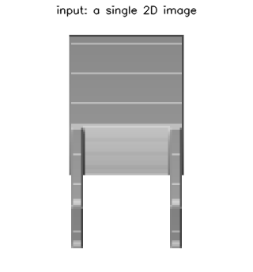
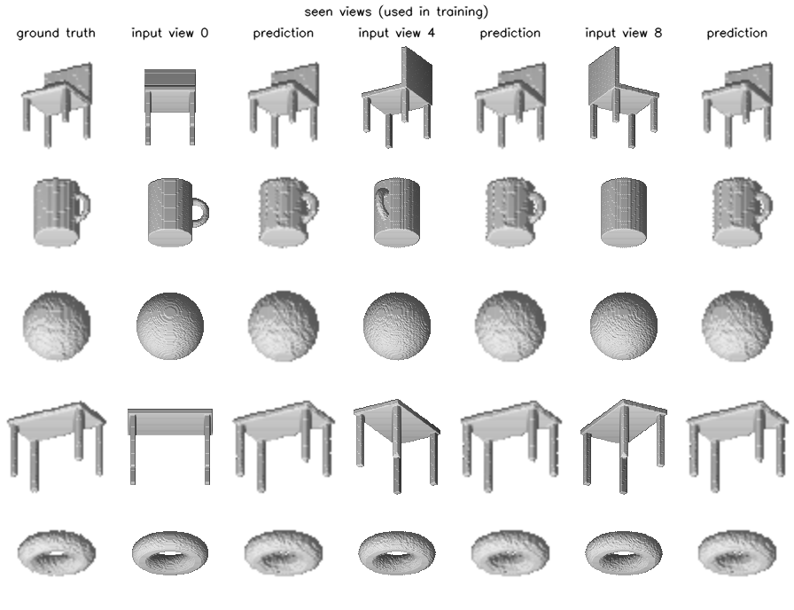
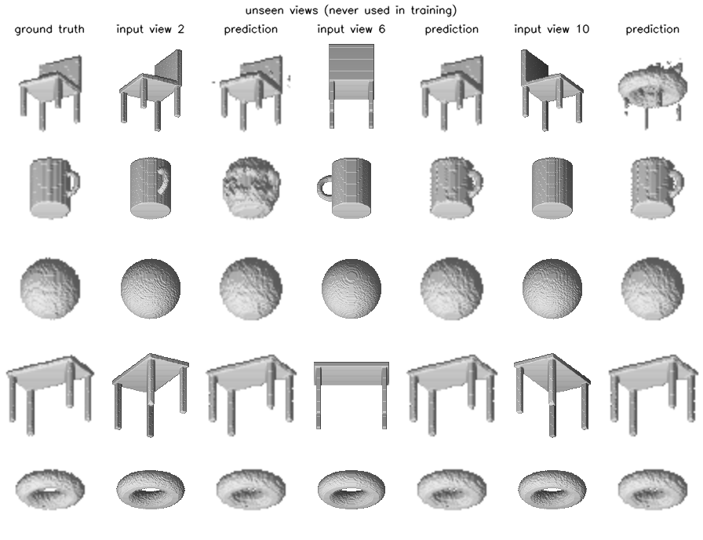
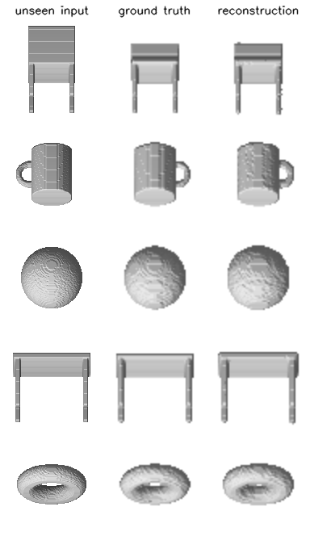

# 3DAttnVAE-GAN

[](https://opensource.org/licenses/MIT)
[](https://github.com/mk314k/3DAttnVAE-GAN/actions/workflows/pylint.yml)

Reconstructs a 3D voxel grid (64×64×64) from 2D images of an object using a VAE-GAN whose encoder is built from attention blocks. It is designed for the ShapeNetCore dataset (over 48,600 3D models across 55 categories).

<p align="center"></p>

*Each shape is reconstructed from one 2D image taken from a viewpoint never seen during training. See [Results](#results-single-view-reconstruction-of-5-shapes).*

## Model
| Part | What it does | Parameters (default config) |
|---|---|---|
| Encoder | Convolutional patch embedding, transformer blocks over the patches of each view, attention across views, then a Gaussian latent code | 0.73M |
| Generator | 3D transposed convolutions from the latent code to 64³ occupancy logits | 4.37M |
| Discriminator | 3D convolutions that score a voxel grid as real or generated (training only) | 11.05M |

The default config has 16.2M parameters (65 MB in fp32). Inference only needs the encoder and generator, which come to 5.1M parameters (20 MB).

Training minimises:
- **Reconstruction:** binary cross-entropy per voxel. `pos_weight` up-weights occupied voxels, because most voxels are empty and an unweighted loss settles on blurry, empty predictions.
- **KL divergence:** between the latent posterior and N(0, I).
- **Adversarial loss:** for the generator, while the discriminator gets its own real-vs-fake loss and optimizer.

The weights are in `config.py`.

## Setup
Requires Python 3.9 to 3.11. All packages are pinned to their November 2023 releases (PyTorch 2.1.1, NumPy 1.26.2), so the project can share an environment with libraries from that period.

```bash
python3 -m venv .venv
source .venv/bin/activate
pip install -r requirements.txt        # training and inference
pip install -r requirements-dev.txt    # additionally pylint and pytest
```

## Training on ShapeNetCore
Place the data in this layout, with 12 rendered views and a voxel grid (`model.mat`, key `input`) per object:

    data/shapenetcore/train_imgs/<object>/000.png ... 011.png
    data/shapenetcore/train_voxels/<object>/model.mat
    data/shapenetcore/test_imgs/<object>/...
    data/shapenetcore/test_voxels/<object>/model.mat

Then run:

```bash
python main.py                                  # defaults from config.py
python main.py --epochs 50 --batch-size 16 --lr 5e-4
python main.py --train-data path/to/train_imgs --test-data path/to/test_imgs
```

Each epoch reports the training losses and the test-set IoU. `checkpoints/last.pt`, `checkpoints/best.pt` (best test IoU) and `checkpoints/training.png` are written as training runs. A GPU is used when available.

By default the encoder fuses all 12 views of an object. For true single-view reconstruction, set `num_views = 1` in `config.py`. Image size, latent size, depth and loss weights are configured there too.

## Inference
```python
import torch
from models import R3D

state = torch.load("checkpoints/best.pt", map_location="cpu")
model = R3D(image_size=(256, 192))   # must match the config used for training
model.load_state_dict(state["model"])
model.eval()

views = torch.rand(1, 12, 1, 256, 192)        # (batch, views, channel, height, width), grayscale in [0, 1]
occupancy = model.reconstruct(views)          # (batch, 64, 64, 64) probabilities
voxels = occupancy >= 0.5
```

`utils.load_views` reads and preprocesses views from disk, and `utils.voxshow` plots a voxel grid.

## Results: single-view reconstruction of 5 shapes
This experiment checks that the model can learn to reconstruct shapes from **one image**. It uses 5 procedurally generated shapes (sphere, torus, chair, table, mug), each rendered from 12 angles 30° apart. The model was trained on 9 views per shape (45 images) for 150 epochs on CPU, about 13 minutes. Views 2, 6 and 10 were held out.

Each row shows the ground truth, then pairs of input image and reconstruction. All voxel grids are rendered from the same angle so they can be compared with the ground truth.





The reconstructions from unseen view 6, rotating next to the ground truth:

<p align="center"></p>

| | Mean IoU | Correct shape |
|---|---|---|
| Seen views (45) | 0.925 | 45 / 45 |
| Unseen views (15) | 0.855 | 13 / 15 |
| Always predicting the average shape | 0.220 | |

The two failures on unseen views show why single-view reconstruction is ambiguous:
- **Mug, view 2:** the handle points away from the camera, so the mug looks like a plain cylinder and the model hedges between shapes.
- **Chair, view 10:** an angle between training views gives a blend of chair and torus.

This shows the pipeline works and that the model handles new viewpoints of shapes it has learned. With only 5 shapes it does **not** show generalisation to unseen objects. That requires training on the full dataset.

To reproduce:

```bash
python -m experiments.overfit_five --epochs 150   # generates data, trains, saves experiments/out/model.pt (48 MB)
python -m experiments.visualize_five              # renders the figures and the GIF from the checkpoint, no training
```

## Tests
```bash
pytest test.py                    # forward shapes, data loading, one training epoch, IoU
pylint $(git ls-files '*.py')
```

Both run in CI on Python 3.9, 3.10 and 3.11.

## Project layout
| Path | Contents |
|---|---|
| `models/` | `R3DAttention`, encoder, generator, discriminator and the `R3D` wrapper |
| `train.py` | Losses, training step, epoch loop, evaluation and IoU |
| `utils.py` | Dataset, image and voxel loading, downsampling, voxel plotting |
| `config.py` | Default hyperparameters |
| `main.py` | Training entry point |
| `experiments/` | The 5-shape experiment and its visualisation |

## References
  - Angel X Chang, Thomas Funkhouser, Leonidas Guibas, Pat
Hanrahan, Qixing Huang, Zimo Li, Silvio Savarese, Manolis
Savva, Shuran Song, Hao Su, et al. Shapenet: An information-
rich 3d model repository. arXiv preprint arXiv:1512.03012,2015.
    
  - Christopher B. Choy, Danfei Xu, JunYoung Gwak, Kevin
Chen, and Silvio Savarese. 3d-r2n2: A unified approach
for single and multi-view 3d object reconstruction. In Com-
puter Vision–ECCV 2016: 14th European Conference, Ams-
terdam, The Netherlands, October 11-14, 2016, Proceedings,
Part VIII, volume 14. Springer International Publishing, 2016.

  - Haoqiang Fan, Hao Su, and Leonidas J Guibas. A point set
generation network for 3d object reconstruction from a single
image. In Proceedings of the IEEE conference on computer
vision and pattern recognition, pages 605–613, 2017. 4

 - Thibault Groueix, Matthew Fisher, Vladimir G Kim, Bryan C
Russell, and Mathieu Aubry. A papier-mˆach ́e approach to
learning 3d surface generation. In Proceedings of the IEEE
conference on computer vision and pattern recognition, pages
216–224, 2018.

  - Xingyuan Sun, Jiajun Wu, Xiuming Zhang, Zhoutong Zhang,
Chengkai Zhang, Tianfan Xue, Joshua B Tenenbaum, and
William T Freeman. Pix3d: Dataset and methods for single-
image 3d shape modeling. In IEEE Conference on Computer
Vision and Pattern Recognition (CVPR), 2018. 1, 3, 4

  - Shubham Tulsiani, Richard Tucker, and Noah Snavely. Multi-
view supervision for single-view reconstruction via differen-
tiable ray consistency. In Proceedings of the IEEE conference
on computer vision and pattern recognition, 2017. 4
